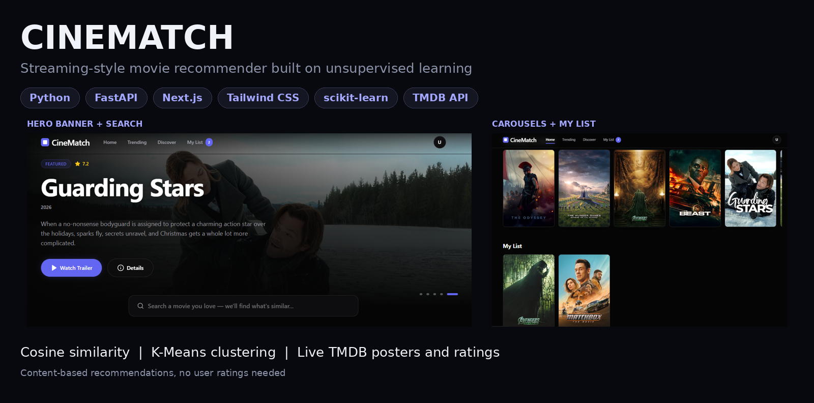
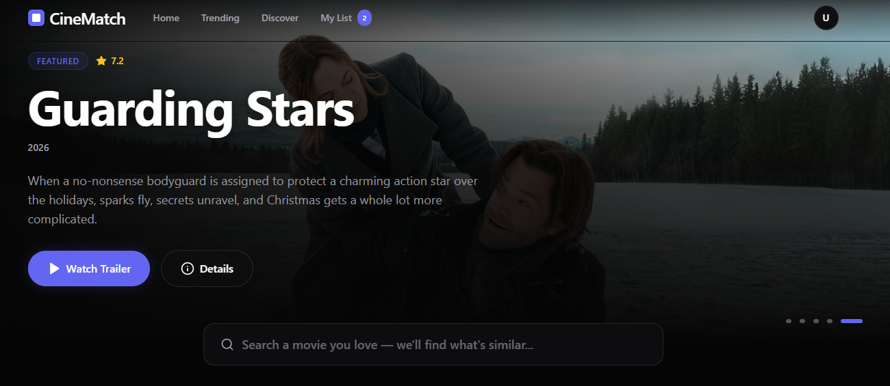
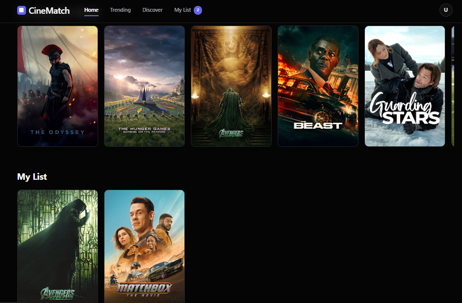

<div align="center">

# 🎬 CineMatch

**A streaming-style movie recommender built on unsupervised learning: Python ML → FastAPI → Next.js + Tailwind, with live posters from TMDB.**

[](https://www.python.org/)
[](https://fastapi.tiangolo.com/)
[](https://nextjs.org/)
[](https://tailwindcss.com/)
[](https://scikit-learn.org/)
[](LICENSE)

### 🔗 [Try the Live Demo →](https://cine-match-plum-gamma.vercel.app/)

<!-- If your backend is on a free tier that sleeps, add this line back:
<sub>The backend runs on a free tier, so the first request after idle time can take 30–60 seconds.</sub> -->

[Features](#features) •
[How it works](#how-the-recommendation-engine-works) •
[Challenges](#challenges-and-how-i-solved-them) •
[API](#api-endpoints) •
[Setup](#setup) •
[Limitations](#limitations)



</div>

---

## Screenshots

**Hero banner and search**



**Carousels and My List**



<!-- Add more screenshots here, for example:


-->

## Features

- **Content-based recommendations** using unsupervised ML (no user ratings or labels needed)
- **Live TMDB data:** posters, backdrops, ratings, cast and genres are fetched at request time
- **Search with autocomplete** from the trained catalog
- **Detail modal** with cast, director, runtime and a "More Like This" row
- **Discover by genre** with pagination
- **Hero banner** that rotates through TMDB's trending movies
- **My List** watchlist saved in the browser (`localStorage`)
- **Loading skeletons** and a responsive dark UI

## How the recommendation engine works

This is a **content-based, unsupervised** recommender. No "user liked / disliked" data is used. Two unsupervised techniques work together:

```text
tmdb_5000_movies.csv + tmdb_5000_credits.csv
        │
        ▼
Feature engineering: overview + genre-boosted genres + keywords + top cast + director
        │
        ▼
CountVectorizer → sparse Bag-of-Words matrix (~5,000 movies × 5,000 terms)
        │
        ├────────────────────────────────┐
        ▼                                ▼
Cosine similarity matrix         TruncatedSVD → K-Means (25 clusters)
(powers /recommend and           (groups the catalog into unlabeled
 /movie/{id}/similar)             "mood / theme" buckets)
        │                                │
        ▼                                ▼
movies.pkl + similarity.pkl      kmeans_model.pkl
              (backend/artifacts/)
```

At request time, `/recommend?movie_title=X` looks up X's row in the similarity matrix, sorts every other movie by score and returns the top N ids. The backend then enriches them with **live** TMDB poster, backdrop, rating, cast and genre data before sending JSON to the frontend.

## Challenges and how I solved them

<!-- Replace or extend these with the real bugs you hit while building (error message, cause, fix). -->

| Challenge | How it was solved |
|---|---|
| **Keeping the TMDB API key secret.** Calling TMDB from the browser would expose the key to anyone using dev tools. | All TMDB calls go through the FastAPI backend. The key lives in the backend `.env` and the frontend only talks to my API. |
| **Too many repeated TMDB requests.** The same movie often appears in several rows at once (trending, recommendations, "More Like This"), which wastes quota and slows the page. | Added an in-memory cache for TMDB responses with a 30-minute lifetime, so repeated movies are served instantly. |
| **Recommendations only work for movies the model knows.** A free-text title that isn't in the trained catalog would return nothing. | `/search` serves autocomplete suggestions from the trained catalog itself, so the user can only pick titles the model can handle. |
| **Raw similarity scores don't make good ranking text.** Ranking by overview text alone gave weak matches. | Built a combined feature text from overview, genre-boosted genres, keywords, top cast and director, so matches reflect genre, people and theme together. |
| **Memory use of the full similarity matrix.** A dense movie × movie matrix grows quadratically with catalog size. | Also trained a `NearestNeighbors` model (`nn_model.pkl`) as a lower-memory path for larger catalogs. |
| **A raw ML result isn't a usable UI.** The model returns ids and scores only. | The backend enriches each id with live TMDB details and the frontend shows a match percentage on hover. |

## API endpoints

| Endpoint | Purpose |
|---|---|
| `GET /health` | Liveness check |
| `GET /search?query=` | Autocomplete suggestions from the trained catalog |
| `GET /recommend?movie_title=&top_n=` | Core ML recommendation, by title |
| `GET /movie/{id}` | Live TMDB summary for one movie |
| `GET /movie/{id}/full` | Summary + cast + director + runtime (detail modal) |
| `GET /movie/{id}/similar?top_n=` | Same ML lookup as `/recommend`, keyed by id |
| `GET /genres` | Distinct genres in the trained catalog |
| `GET /discover?genre=&sort_by=&page=` | Browse and filter the catalog by genre, paginated |
| `GET /trending?window=day\|week` | Live TMDB trending list (hero banner and row) |

## Folder structure

```text
CineMatch/
├── data/                      # Kaggle CSVs go here (not included)
│   ├── tmdb_5000_movies.csv
│   └── tmdb_5000_credits.csv
├── ml/
│   └── train_model.py         # preprocessing, vectorizing, similarity, K-Means, pickling
├── backend/
│   ├── main.py                # FastAPI app
│   ├── requirements.txt
│   ├── .env.example           # copy to .env and add TMDB_API_KEY
│   └── artifacts/             # generated by train_model.py
└── frontend/
    ├── app/                   # layout.tsx, page.tsx, globals.css
    ├── components/            # Navbar, HeroBanner, SearchBar, MovieCarousel,
    │                          # MovieCard, MovieModal, DiscoverSection, Skeleton
    ├── lib/                   # api.ts (typed API client), useWatchlist.ts
    ├── .env.local.example
    ├── package.json
    ├── tailwind.config.js
    ├── next.config.js
    └── tsconfig.json
```

## Setup

### Prerequisites

- Python 3.10+
- Node.js 18+
- A free [TMDB API key](https://www.themoviedb.org/settings/api)
- The [TMDB 5000 Movie Dataset](https://www.kaggle.com/datasets/tmdb/tmdb-movie-metadata) from Kaggle (`tmdb_5000_movies.csv` and `tmdb_5000_credits.csv`)

### 1. Clone and add the dataset

```bash
git clone https://github.com/Sohel123-png/CineMatch.git
cd CineMatch
```

Place both CSV files inside `data/`.

### 2. Train the model

```bash
python -m venv venv
source venv/bin/activate        # Windows: venv\Scripts\activate
pip install -r backend/requirements.txt

python ml/train_model.py
```

This writes the model files (`movies.pkl`, `similarity.pkl`, `nn_model.pkl`, `vectors.pkl` and `kmeans_model.pkl`) into `backend/artifacts/`.

### 3. Run the backend

```bash
cd backend
cp .env.example .env
# edit .env and set TMDB_API_KEY=your_real_key

uvicorn main:app --reload --port 8000
```

Check it at <http://localhost:8000/health>. Interactive docs are at <http://localhost:8000/docs>. Try:

```text
GET http://localhost:8000/recommend?movie_title=The Dark Knight
GET http://localhost:8000/trending
```

### 4. Run the frontend

```bash
cd frontend
cp .env.local.example .env.local
# NEXT_PUBLIC_API_BASE_URL=http://localhost:8000 (the default is already correct)

npm install
npm run dev
```

Open <http://localhost:3000>.

### 5. Use it

1. The hero banner rotates through TMDB's trending movies.
2. Type a title in the search bar and pick a suggestion.
3. A "Because you like X" row appears with a match percentage on hover.
4. Click a poster for the detail modal (overview, cast, director and "More Like This").
5. Use **+** to add a movie to **My List**, which is saved in your browser.
6. Scroll to **Discover by Genre** to filter and page through the catalog.

## Swapping the similarity method

`ml/train_model.py` uses `CountVectorizer` (Bag-of-Words). To try TF-IDF instead:

```python
from sklearn.feature_extraction.text import TfidfVectorizer
vectorizer = TfidfVectorizer(max_features=5000, stop_words="english")
```

## Limitations

- The model is content-based, so it never learns from real user behavior.
- It only knows the ~5,000 movies in the TMDB 5000 dataset, so newer releases are not recommendable (they can still show up in the live trending row).
- The K-Means model (`kmeans_model.pkl`, 25 clusters) is trained but not connected to an endpoint yet.
- The full similarity matrix is dense, so it does not scale well to very large catalogs.

## Roadmap

- [ ] `/movie/{id}/cluster` endpoint that returns movies from the same K-Means cluster
- [ ] Evaluate recommendation quality (for example, genre overlap or a small manual relevance check)
- [ ] Switch to the `NearestNeighbors` path for a larger catalog
- [ ] Tests for the API endpoints

## Production notes

- Restrict `allow_origins` in the CORS config in `backend/main.py` to your real frontend domain.
- Keep `TMDB_API_KEY` server-side only. The frontend calls your backend, not TMDB.

## Author

**Sohel Ali**: [GitHub](https://github.com/Sohel123-png) · [LinkedIn](https://www.linkedin.com/in/sohel-ali-6435253a8/) · sayyedsohelali448@gmail.com

## Credits

This product uses the TMDB API but is not endorsed or certified by TMDB. Movie metadata and images are provided by [TMDB](https://www.themoviedb.org/). The recommendation model is trained on the TMDB 5000 Movie Dataset from Kaggle.

## License

Released under the [MIT License](LICENSE).
